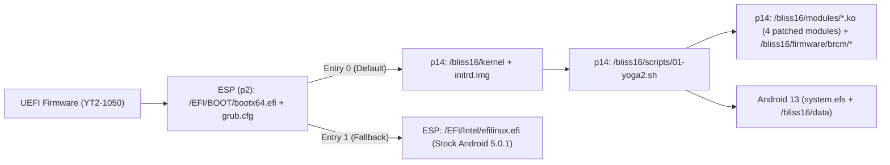

# BlissOS 16.9.7 (Android 13 Go, Kernel 6.1) on Lenovo Yoga Tablet 2 10.1" (`YT2-1050L` / `YT2-1050F`) — Complete Dual-Boot & Hardware Fix Guide

A complete, self-contained engineering guide to running **Android 13 (BlissOS 16.9.7 Go Edition, Linux kernel `6.1.112-gloria-xanmod1`)** on the **Lenovo Yoga Tablet 2 10.1"** (`YT2-1050L` LTE and `YT2-1050F` Wi-Fi) in a **non-destructive dual-boot** setup alongside Stock Android 5.0.1—without repartitioning the internal 16 GB eMMC.

---

## What Works (Status Matrix)

| Subsystem | Status | Implementation Summary |
|---|---|---|
| **Dual-Boot (BlissOS 13 + Stock 5.0.1)** | Working | Standalone GRUB EFI on `ESP` (`p2`), BlissOS lives in `/bliss16/` on shared `userdata` (`p14`) |
| **Display & Backlight (`1920x1200`)** | Working | `i915.modeset=1` + Crystal Cove PMIC `0x0B` TCON rail via kernel 6.1 `x86-android-tablets` |
| **Touchscreen (Synaptics RMI4)** | Working | Registered automatically at `i2c-4` `0x38` by `x86-android-tablets` + `rmi_i2c` (no custom DSDT needed!) |
| **Wi-Fi (Broadcom BCM43241B4 SDIO)** | Working | Stock NVRAM + binary-patched `brcmfmac.ko` (`MMC_PM_KEEP_POWER` in `s2idle` — survives sleep/wake!) |
| **Bluetooth (BCM4324B3 UART)** | Working | `BCM4324B3.hcd` patchram loaded via `hci_uart` + auto-enabled on boot |
| **Audio (Wolfson WM5102 SPI + SST)** | Working | Binary-patched `spi-pxa2xx-platform.ko` (force `CS0`) + `arizona.ko` + strict LDO power-up sequence |
| **Auto-Rotation & Light Sensor (IIO)** | Working | Binary-patched `st_accel_i2c.ko` (`lsm9ds0` at `0x1d`) + `al3320a` (`0x1c`) on `i2c-4` |
| **Hardware Video Decoding (H.264)** | Working | Zero-copy VA-API DRM PRIME (`c2.ffmpeg.h264.decoder` on Intel Gen 7 `i965`, <3% CPU load) |
| **Widevine L3 DRM & VOD Streaming** | Working | **Netflix** (`8.118.0`), **HBO Max** (`22.0.0.321`), **Prime Video** (`Jellyfish` Desktop WebView), **YouTube** (`NewPipe` `720p60`) |
| **ARM / ARM64 App Translation** | Working | `libndk_translation` with `private` mount propagation fix for `/system/etc/cpuinfo.arm*.txt` |
| **Memory Management (2 GB RAM)** | Working | `1.0 GiB` `zram0` (`lz4`), MGLRU (`lru_gen=7`), `ro.config.low_ram=true`, OpenGL ES `threaded` renderer |
| **Google Password Manager Autofill** | Working | Reactivated `com.google.android.gms.autofill.*` components + `chromesync`-only background policy |
| **Root Access (Stealth ADB Root)** | Working | Direct `uid=0(root)` via `adbd` over Wi-Fi (`:5555`) & USB RNDIS (`192.168.77.2`), invisible to VOD apps |

---

## 1. Hardware Overview & Why Kernel 6.1 Changes Everything

| Parameter | Specification |
|---|---|
| **Device Models** | Lenovo Yoga Tablet 2 10.1" LTE (`YT2-1050L`) / Wi-Fi (`YT2-1050F`) |
| **SoC / GPU** | Intel Atom Z3745 (Bay Trail-T, 4 cores @ 1.33–1.86 GHz, `x86_64`) + Intel HD Graphics (Valleyview Gen 7) |
| **RAM / Storage** | 2 GB LPDDR3 (`1848 MiB` usable + `1024 MiB` `zram0` `lz4`) / 16 GB internal eMMC (`mmcblk1` in Linux 6.1) |
| **UEFI Architecture** | 64-bit UEFI on Android 5.0.1 BIOS (`bootx64.efi`); some early KitKat 4.4 BIOS revisions use 32-bit UEFI (`bootia32.efi`) |
| **ESP Partition** | Partition `p2` (`LABEL="ESP"`, FAT32, ~33 MB) |
| **Shared Data Partition** | Partition `p14` (`userdata`, ext4, ~11 GB — mounted as `/data` in Stock Android 5.0.1) |
| **Target OS Image** | `Bliss-Go-v16.9.7-x86_64-OFFICIAL-gapps-20241012.iso` (Android 13 Go, kernel `6.1.112-gloria-xanmod1`) |
| **SHA1 (ISO)** | Verify on SourceForge under *BlissOS Go 16.9.7 x86_64 GApps (`2024-10-12`)* |

### Why Older Android-x86 / Kernel 4.9 Builds Failed on Yoga Tablet 2
On older Linux 4.9 builds (BlissOS 7.1 / 11), the touchscreen and display failed out of the box for two reasons:
1. **Missing TCON Power Rail (`0x0B`):** The Intel Crystal Cove PMIC driver in kernel 4.9 only mapped 2 power rails and lacked register `0x0B` (the Timing Controller power rail required by both the LCD panel and Synaptics touchscreen).
2. **Broken ACPI DSDT I2C Bus Speed:** Lenovo's stock BIOS DSDT table declared an invalid I2C bus frequency (`100 kHz` vs `400 kHz`), causing I2C probe failure (`error -22`) unless a custom recompiled `DSDT.aml` was injected via `initrd`.

**In Kernel 6.1 (`BlissOS 16.9.7`):** Hans de Goede's mainline `x86-android-tablets` driver contains dedicated board code for the **Lenovo Yoga Tablet 2 1050F/L**. It automatically enables the Crystal Cove `0x0B` TCON power rail, configures the I2C bus, and registers the Synaptics RMI4 touchscreen (`0x38`), Wolfson WM5102 audio codec, and battery fuel gauge **without any custom `DSDT.aml` override**.

---

## 2. How Root Access Was Obtained (Stock Android 5.0.1 & BlissOS 16.9.7)

Installing a dual-boot setup without wiping or repartitioning the tablet requires root access in two stages:

### Stage 1: Rooting Stock Lenovo Android 5.0.1 (Bootstrapping Dual-Boot)
To write GRUB onto the hidden EFI System Partition (`p2`) and place BlissOS inside `/data/bliss16/` on `p14`, you first need root (`uid=0`) on Stock Android 5.0.1 (or a temporary TWRP recovery shell):

1. **Enable Developer Options & USB Debugging** in Stock Android 5.0.1 (*Settings → About tablet → tap Build number 7 times*).
2. **Enter Intel Droidboot / Fastboot Mode:**
   ```bash
   adb reboot bootloader
   ```
   *(Alternatively, power off the tablet and hold **Power + Volume Down** until the Fastboot screen appears.)*
3. **Unlock the Bootloader & Boot Temporary TWRP:**
   - Download the Bay Trail `YT2-1050` TWRP recovery image (`twrp-yt2-1050.img`, e.g., from the XDA Yoga Tab 2 thread) and Magisk v23.0 (or SuperSU ZIP):
   ```bash
   fastboot oem unlock
   fastboot boot twrp-yt2-1050.img
   ```
   - Note: `fastboot boot` loads TWRP into RAM **without overwriting** your stock recovery partition (`p4`).
   - Once TWRP is running, you immediately have a full root `adb shell` (`#`), or you can flash Magisk v23.0 / SuperSU to have persistent `su` inside Stock Android 5.0.1.

### Stage 2: Stealth Root Architecture in BlissOS 16.9.7 (Android 13)
BlissOS 16.9.7 ships with kernel `6.1.112-gloria-xanmod1` (which includes built-in **KernelSU** and the `me.weishu.kernelsu` manager app) plus an `adbd` daemon compiled with `ro.debuggable=1`. However, standard visible root breaks **Netflix** and **Widevine DRM**.

We achieve **permanent root control that is 100% invisible to VOD apps** using a two-layer architecture:
1. **Layer 1 — Early-Boot `initrd` Root Hook (`/bliss16/scripts/01-yoga2.sh`):**
   - During boot, `initrd.img` runs as `uid=0 (root)` before Android `init` starts and automatically sources `/src/scripts/01-yoga2.sh`.
   - Even though `/system` (`system.efs`) is a read-only EROFS image, `01-yoga2.sh` copies target files to `tmpfs` (`/tmp`), modifies them on the fly, and overlays them via `mount --bind` (replacing kernel `.ko` modules, `fstab`, `init.rc`, `init.sh`, and all 7 `build.prop` files).
2. **Layer 2 — Direct Root `adbd` (`uid=0`, `context=u:r:su:s0`) Without Exposing `su`:**
   - `01-yoga2.sh` scrubs `userdebug` and `test-keys` from all 7 partition `build.prop` files (spoofing a certified Google Pixel 5 `redfin-user 13 release-keys` build) and we freeze `me.weishu.kernelsu` (`pm disable-user --user 0 me.weishu.kernelsu`).
   - Because `ro.debuggable=1` remains active for `adbd`, every `adb shell` connection over Wi-Fi (`:5555`) or USB RNDIS (`192.168.77.2:5555`) drops directly into **`uid=0(root) gid=0(root) context=u:r:su:s0`**—giving full root administration without a user-visible `su` binary.

---

## 3. Boot Architecture & Directory Layout



Target directory layout inside `/bliss16` at the root of partition `p14` (which is `/data/bliss16` when viewed from Stock Android 5.0.1):

```text
/bliss16/
├── kernel                        # extracted from BlissOS 16.9.7 ISO
├── initrd.img                    # extracted from BlissOS 16.9.7 ISO (unmodified!)
├── system.efs                    # EROFS system image from ISO (~2.1 GB)
├── data/                         # Android 13 /data directory (chmod 771, chown 1000:1000)
│   └── adb/adb_keys              # your PC's ~/.android/adbkey.pub (pre-authorizes ADB)
├── scripts/
│   └── 01-yoga2.sh               # initrd hook script automatically sourced via /src/scripts/*
├── firmware/
│   └── brcm/
│       ├── brcmfmac43241b4-sdio.txt           # Wi-Fi NVRAM calibration from Stock Android 5.0.1
│       ├── brcmfmac43241b4-sdio.bin.fallback  # fallback Wi-Fi firmware from Stock Android 5.0.1
│       └── BCM4324B3.hcd                      # Bluetooth patchram firmware from Stock Android 5.0.1
└── modules/
    ├── spi-pxa2xx-platform.ko    # patched SPI controller module (force hardware CS0 for WM5102)
    ├── arizona.ko                # patched Arizona MFD module (bypass Bay Trail IRQ probe abort)
    ├── st_accel_i2c.ko           # patched IIO accelerometer module (add "lsm9ds0" ID at 0x1d)
    └── brcmfmac.ko               # patched Broadcom Wi-Fi module (force MMC_PM_KEEP_POWER in s2idle)
```

---

## 4. Step-by-Step Preparation from Stock Android 5.0.1 (or TWRP)

Connect to the tablet over ADB and open a root shell (`adb shell` → `su`).

### Step 1: Create `/data/bliss16` Directory Structure
Check free space on `/data` (`df -h /data` — you need at least **3.0–3.5 GB free** for `system.efs` + `/bliss16/data`), then run:

```sh
mkdir -p /data/bliss16/data/adb /data/bliss16/scripts /data/bliss16/modules /data/bliss16/firmware/brcm
chmod 771 /data/bliss16/data
chown 1000:1000 /data/bliss16/data
```

### Step 2: Back Up Board-Specific Broadcom Wi-Fi & Bluetooth Firmware from Stock Android
The Broadcom BCM43241B4 combo chip requires the NVRAM calibration text file and Bluetooth `.hcd` patchram from Lenovo's Stock ROM. Run in the tablet's root shell:

```sh
# Copy Wi-Fi NVRAM calibration file
for f in /etc/wifi/brcmfmac43241b4-sdio.txt /vendor/firmware/brcmfmac43241b4-sdio.txt /etc/firmware/nvram.txt; do
    [ -f "$f" ] && cp "$f" /data/bliss16/firmware/brcm/brcmfmac43241b4-sdio.txt && break
done

# Copy fallback Wi-Fi binary firmware from Stock Android
for f in /etc/wifi/brcmfmac43241b4-sdio.bin /vendor/firmware/fw_bcmdhd.bin; do
    [ -f "$f" ] && cp "$f" /data/bliss16/firmware/brcm/brcmfmac43241b4-sdio.bin.fallback && break
done

# Copy Bluetooth patchram (.hcd)
for f in /etc/firmware/BCM4324B3.hcd /etc/bluetooth/BCM4324B3.hcd /vendor/firmware/BCM4324B3.hcd; do
    [ -f "$f" ] && cp "$f" /data/bliss16/firmware/brcm/BCM4324B3.hcd && break
done

# Optional: record your real hardware Wi-Fi MAC address into brcmfmac43241b4-sdio.txt
WIFI_MAC=$(cat /sys/class/net/wlan0/address 2>/dev/null)
if [ -n "$WIFI_MAC" ] && [ -f /data/bliss16/firmware/brcm/brcmfmac43241b4-sdio.txt ]; then
    sed -i "s/^macaddr=.*/macaddr=${WIFI_MAC}/" /data/bliss16/firmware/brcm/brcmfmac43241b4-sdio.txt
fi
```

### Step 3: Pre-Authorize Your PC's ADB Key
From your PC, push your public ADB key (`~/.android/adbkey.pub`) so wireless and USB ADB are pre-authorized on first boot:

```bash
adb push ~/.android/adbkey.pub /data/bliss16/data/adb/adb_keys
adb shell "su -c 'chmod 640 /data/bliss16/data/adb/adb_keys'"
```

### Step 4: Extract and Push `kernel`, `initrd.img`, and `system.efs` from the BlissOS ISO
On your Linux PC, mount the ISO and push the three core files to `/data/bliss16/`:

```bash
mkdir -p /tmp/bliss_iso
sudo mount -o loop,ro Bliss-Go-v16.9.7-x86_64-OFFICIAL-gapps-20241012.iso /tmp/bliss_iso

adb push /tmp/bliss_iso/kernel /data/bliss16/kernel
adb push /tmp/bliss_iso/initrd.img /data/bliss16/initrd.img
adb push /tmp/bliss_iso/system.efs /data/bliss16/system.efs
```

---

## 5. Binary Kernel Module Patches (`6.1.112-gloria-xanmod1`) — Linux Commands

Four kernel modules inside `system.efs` (`/system/lib/modules/6.1.112-gloria-xanmod1/kernel/...`) require surgical binary patches to work properly with the `YT2-1050` hardware. Rather than repacking the 2.1 GB `system.efs` image, we place the 4 patched `.ko` files in `/bliss16/modules/` and `01-yoga2.sh` bind-mounts them into `/android/system/lib/modules/...` during `initrd` before `auto_detect` runs.

### Step 1: Extract the 4 Original Modules on Linux
```bash
mkdir -p /tmp/bliss_sys ./modules
sudo mount -t erofs -o loop,ro /tmp/bliss_iso/system.efs /tmp/bliss_sys

KMOD_DIR="/tmp/bliss_sys/system/lib/modules/6.1.112-gloria-xanmod1/kernel"
cp "$KMOD_DIR/drivers/spi/spi-pxa2xx-platform.ko" ./modules/
cp "$KMOD_DIR/drivers/mfd/arizona.ko" ./modules/
cp "$KMOD_DIR/drivers/iio/accel/st_accel_i2c.ko" ./modules/
cp "$KMOD_DIR/drivers/net/wireless/broadcom/brcm80211/brcmfmac/brcmfmac.ko" ./modules/
chmod 644 ./modules/*.ko

sudo umount /tmp/bliss_sys /tmp/bliss_iso
```
*(If your host kernel does not have `erofs` mounted, you can also extract files using `fsck.erofs --extract=/tmp/bliss_sys /tmp/bliss_iso/system.efs` from `erofs-utils`.)*

### Step 2: Apply the Binary Patches on Linux

#### Patch 1: `spi-pxa2xx-platform.ko` (`43,040` bytes) — Fix Wolfson WM5102 SPI Chip Select (`CS1` → `CS0`)
- **Why it is needed:** `x86-android-tablets` registers `spi-10WM5102:00` on `chip_select = 1` (`CS1`), but on the `YT2-1050` PCB the Wolfson WM5102 audio codec is physically wired to hardware `CS0` of the SSP2 SPI controller. Without this patch, SPI reads return `0xFFFF` and audio fails to probe.
- **What the patch does:** Replaces the `chip_select` read instructions at file offsets `0x20C6` and `0x342F` with `xor eax,eax` / `xor edx,edx` + `nop` padding so the controller always drives `CS0`.
- **Linux commands:**
  ```bash
  printf '\x31\xc0\x90\x90\x90\x90' | dd of=./modules/spi-pxa2xx-platform.ko bs=1 seek=$((0x20c6)) conv=notrunc status=none
  printf '\x31\xd2\x90\x90\x90\x90\x90' | dd of=./modules/spi-pxa2xx-platform.ko bs=1 seek=$((0x342f)) conv=notrunc status=none
  ```

#### Patch 2: `arizona.ko` (`142,640` bytes) — Bypass Bay Trail IRQ Probe Abort in `arizona_dev_init`
- **Why it is needed:** During `arizona_dev_init`, an IRQ check takes a long conditional jump (`je +0x181`) that aborts initialization on Bay Trail before the WM5102 codec subdevices are registered.
- **What the patch does:** Shortens the `je` displacement at file offset `0x12ABF–0x12AC0` from `81 01` to `0D 00` so initialization completes cleanly.
- **Linux command:**
  ```bash
  printf '\x0d\x00' | dd of=./modules/arizona.ko bs=1 seek=$((0x12abf)) conv=notrunc status=none
  ```

#### Patch 3: `st_accel_i2c.ko` (`20,520` bytes) — Add `"lsm9ds0"` I2C ID for the Accelerometer (`0x1d` on `i2c-4`)
- **Why it is needed:** The onboard STMicroelectronics `LSM303D` / `LSM9DS0` accelerometer sits at `0x1d` on `i2c-4` and is instantiated via `/sys/bus/i2c/devices/i2c-4/new_device` as `lsm9ds0`.
- **What the patch does:** Writes the ASCII string `"lsm9ds0\0"` into the module's I2C device ID table at file offset `0x1790`.
- **Linux command:**
  ```bash
  printf 'lsm9ds0\x00' | dd of=./modules/st_accel_i2c.ko bs=1 seek=$((0x1790)) conv=notrunc status=none
  ```

#### Patch 4: `brcmfmac.ko` (`695,472` bytes) — Fix Wi-Fi Death After `s2idle` Sleep (`CMD_RECOVERY_DISABLE_WIFI`)
- **Why it is needed:** In `brcmf_ops_sdio_suspend`, `brcmfmac` checks `bus->wowl_enabled` (`0x430(%rbx)`). Because WoWLAN is not enabled for BCM43241B4, every `s2idle` suspend called `brcmf_sdiod_remove` (destroying `wlan0` and `phy#0`), and resume re-probed the chip as a new `phy#1, 2, 3...`. Android's `wificond` (still bound to `phy#0`) failed with `Failed to get wiphy info` and triggered `WifiSelfRecovery` (`CMD_RECOVERY_DISABLE_WIFI`), permanently turning Wi-Fi off after waking the screen.
- **What the patch does (`.text` section at file offset `0x104c0`):**
  - Offset `0x4376E`: `0F 84 AB 00 00 00` → `90 90 90 90 90 90` (NOP out the `je` branch to `brcmf_sdiod_remove` so SDIO power is always kept during `s2idle`).
  - Offset `0x438BB`: `41 BE 03 00 00 00` → `41 BE 01 00 00 00` (set `mmc_pm_flag_t` to `MMC_PM_KEEP_POWER = 0x1` instead of `0x3`, avoiding unsupported `MMC_PM_WAKE_SDIO_IRQ`).
  - Offset `0x43961`: `74 6C` → `90 90` (in `brcmf_ops_sdio_resume`, skip re-probing via `brcmf_sdiod_probe` and directly wake the SDIO bus).
- **Linux commands:**
  ```bash
  printf '\x90\x90\x90\x90\x90\x90' | dd of=./modules/brcmfmac.ko bs=1 seek=$((0x4376e)) conv=notrunc status=none
  printf '\x41\xbe\x01\x00\x00\x00' | dd of=./modules/brcmfmac.ko bs=1 seek=$((0x438bb)) conv=notrunc status=none
  printf '\x90\x90' | dd of=./modules/brcmfmac.ko bs=1 seek=$((0x43961)) conv=notrunc status=none

  md5sum ./modules/brcmfmac.ko
  # Expected MD5: aa7c4e98b23d74cb4b20b5e20f2e1a2d  ./modules/brcmfmac.ko
  ```

### Step 3: Push the Patched Modules to the Tablet
```bash
adb push ./modules/*.ko /data/bliss16/modules/
adb shell "su -c 'chmod 644 /data/bliss16/modules/*.ko'"
```

---

## 6. Startup Hook Script `/bliss16/scripts/01-yoga2.sh`

> [!CAUTION]
> `01-yoga2.sh` **must** use Unix line endings (**LF**, no `CR`) and **UTF-8 without BOM** encoding (`chmod 755`). Any Windows `CRLF` characters will cause syntax errors in `busybox ash` during `initrd` boot!

### Key Engineering Fixes Performed by `01-yoga2.sh`
1. **Early Kernel Module & Firmware Injection (`yoga_early_prep`):**
   - Runs as soon as `initrd` sources `/src/scripts/01-yoga2.sh` (before `auto_detect` loads kernel modules), bind-mounting the 4 patched `.ko` files and setting `/sys/module/firmware_class/parameters/path` to `/tmp/fw_yoga`.
2. **Strict Power-Sequenced Audio & Sensor Bring-Up (`post_detect`):**
   - Unloads any prematurely probed audio/sensor modules, loads `arizona-ldo1`, `arizona-micsupp`, `gpio-arizona`, `snd-soc-wm5102`, `spi-pxa2xx-platform`, and `arizona-spi`, waits for `spi-10WM5102:00/driver` to bind, and then loads `snd-soc-sst-bytcr-wm5102`. Also removes any corrupted 0-byte `/data/vendor/asound.state`.
3. **1.0 GiB `lz4` `zram` & MGLRU Memory Tuning:**
   - Loads `lz4.ko`, resets `zram0`, configures a `1073741824`-byte (`1.0 GiB`) `lz4` compressed swap device, and enables Multi-Gen LRU (`lru_gen/enabled = 7`) with `page-cluster = 0`.
4. **Fix for the Critical $2^N$ Mount Propagation Explosion (`cpuinfo.arm*.txt`):**
   - **The Bug:** BlissOS mounts `/` as `shared:1`. Every time an ARM/ARM64 app (Netflix, HBO Max) starts, `libnativebridge.so` runs `mount --bind /system/etc/cpuinfo.arm64.txt /proc/cpuinfo`. Because `/system/etc/cpuinfo.arm64.txt` sits on `/` (`shared:1`), the Linux kernel propagated the new mount back to the source inside `shared:1`, **doubling the number of mounts in `/proc/1/mountinfo` on every single app launch** ($2^N$ growth: `100` → `1,000` → `65,000` → `>700,000` lines). This pegged `init` (PID 1) at 100% CPU parsing `/proc/1/mountinfo`, created zombie processes, and broke lazy HAL services (`widevine`).
   - **The Fix:** `01-yoga2.sh` bind-mounts `cpuinfo.arm.txt` and `cpuinfo.arm64.txt` from `/tmp` (`tmpfs`) and marks both mount points as **`private`** in `on post-fs`. `/proc/1/mountinfo` stays permanently at **~98–100 lines**.
5. **Fix for the False `SystemUI` "Issue with SD card — Tap to fix" Notification (`fstab`):**
   - **The Bug:** `/fstab.bliss_x86_64` and `/vendor/etc/fstab.internal.x86` contain the wildcard `/devices/*/80860F*:*/mmc_* ... voldmanaged=sdcard1:auto`. On `YT2-1050`, `80860F14:00` (`mmc1` / `mmcblk1`) is the **soldered internal 16 GB eMMC**, while `80860F14:01` (`mmc2`) is the **external microSD card slot**. Because the wildcard matched `80860F14:00`, `vold` treated raw internal boot partitions (`boot`, `recovery`, `fastboot`, `oem`, `panic`, `mmcblk1boot0`) as corrupted external SD cards (`public:179,1..8`).
   - **The Fix:** `01-yoga2.sh` replaces `80860F*:*` with `80860F14:01` in all `fstab` files before `init` and `vold` start.
6. **Widevine L3 Certification Spoofing & Low-RAM Tuning (`build.prop`):**
   - Bind-mounts all 7 partition `build.prop` files (`system`, `vendor`, `product`, `system_ext`, `system_dlkm`, `odm`, `vendor_dlkm`) with a certified `google/redfin/redfin:13/TQ3A.230901.001.C1/10750268:user/release-keys` fingerprint, `ro.config.low_ram=true`, `ro.hwui.use_vulkan=false`, capped HWUI caches, and `ro.sys.fw.bg_apps_limit=4`.
7. **Google Password Manager Autofill Reactivation (`post_bootcomplete`):**
   - Because `ro.config.low_ram=true` causes Google Play Services (`com.google.android.gms`) to disable its internal `AutofillService` component, `post_bootcomplete()` explicitly re-enables all 13 `com.google.android.gms.autofill.*` components and sets `autofill_service` to Google.

### Full Contents of `/bliss16/scripts/01-yoga2.sh`

Save the following script as `01-yoga2.sh` and push it to `/data/bliss16/scripts/01-yoga2.sh` (`chmod 755`):

```sh
# Yoga Tablet 2 (YT2-1050L / YT2-1050F) initrd hook for BlissOS 16

yoga_early_prep()
{
	[ -n "$_YOGA_EARLY_DONE" ] && return 0
	_YOGA_EARLY_DONE=1

	# 1. Bind-mount patched kernel modules BEFORE auto_detect/load_modules
	MODSRC=""
	for d in /src/modules /mnt/bliss16/modules; do
		[ -d "$d" ] && MODSRC="$d" && break
	done
	if [ -n "$MODSRC" ] && [ -d /android/system/lib/modules ]; then
		mkdir -p /tmp/yoga_mods
		for m in arizona.ko spi-pxa2xx-platform.ko st_accel_i2c.ko brcmfmac.ko; do
			if [ -f "$MODSRC/$m" ]; then
				cp "$MODSRC/$m" "/tmp/yoga_mods/$m"
				chmod 644 "/tmp/yoga_mods/$m"
				tgt=$(busybox find /android/system/lib/modules -name "$m" 2>/dev/null | busybox head -n 1)
				if [ -n "$tgt" ]; then
					mount --bind "/tmp/yoga_mods/$m" "$tgt" 2>/dev/null || true
				fi
			fi
		done
	fi

	# 2. Prepare Broadcom Wi-Fi & BT firmware BEFORE auto_detect loads brcmfmac/hci_uart
	for r in /sys/class/rfkill/*; do
		[ -e "$r/state" ] && echo 1 > "$r/state" 2>/dev/null || true
	done

	FWSRC=""
	for d in /src/firmware/brcm /mnt/bliss16/firmware/brcm; do
		[ -d "$d" ] && FWSRC="$d" && break
	done

	mkdir -p /tmp/fw_yoga/brcm
	if [ -f /android/vendor/firmware/brcm/brcmfmac43241b4-sdio.bin.zst ]; then
		cp /android/vendor/firmware/brcm/brcmfmac43241b4-sdio.bin.zst /tmp/fw_yoga/brcm/brcmfmac43241b4-sdio.bin.zst
	elif [ -n "$FWSRC" ] && [ -f "$FWSRC/brcmfmac43241b4-sdio.bin.fallback" ]; then
		cp "$FWSRC/brcmfmac43241b4-sdio.bin.fallback" /tmp/fw_yoga/brcm/brcmfmac43241b4-sdio.bin
	fi

	if [ -n "$FWSRC" ] && [ -f "$FWSRC/brcmfmac43241b4-sdio.txt" ]; then
		cp "$FWSRC/brcmfmac43241b4-sdio.txt" /tmp/fw_yoga/brcm/brcmfmac43241b4-sdio.txt
		cp /tmp/fw_yoga/brcm/brcmfmac43241b4-sdio.txt "/tmp/fw_yoga/brcm/brcmfmac43241b4-sdio.Intel Corp.-VALLEYVIEW C0 PLATFORM.txt"
	fi
	if [ -n "$FWSRC" ] && [ -f "$FWSRC/BCM4324B3.hcd" ]; then
		cp "$FWSRC/BCM4324B3.hcd" /tmp/fw_yoga/brcm/BCM4324B3.hcd
		cp "$FWSRC/BCM4324B3.hcd" /tmp/fw_yoga/brcm/BCM.hcd
	fi

	chmod 755 /tmp/fw_yoga /tmp/fw_yoga/brcm
	chmod 644 /tmp/fw_yoga/brcm/* 2>/dev/null || true

	echo -n "/tmp/fw_yoga" > /sys/module/firmware_class/parameters/path 2>/dev/null || true
	rm -f /lib/firmware 2>/dev/null || true
	ln -s /tmp/fw_yoga /lib/firmware
}

# Run early prep immediately during initrd source (before load_modules/auto_detect)
yoga_early_prep

post_detect()
{
	DIAG=/android/data/boot_diag
	mkdir -p "$DIAG"
	chmod 777 "$DIAG"

	{
		echo "=== uname ==="
		uname -a
		echo "=== cmdline ==="
		cat /proc/cmdline

		echo "=== modprobe i915 ==="
		busybox modprobe -v i915 modeset=1 2>&1
		echo "modprobe i915 rc=$?"

		i=0
		while [ $i -lt 3 ]; do
			[ -e /dev/dri/card0 ] && break
			sleep 1
			i=$((i + 1))
		done

		echo "=== modprobe x86-android-tablets & touch ==="
		busybox modprobe -v x86-android-tablets 2>&1
		echo "modprobe x86-android-tablets rc=$?"
		busybox modprobe -v rmi_core 2>&1
		busybox modprobe -v rmi_i2c 2>&1
		echo "modprobe rmi_i2c rc=$?"

		echo "=== verify patched kernel modules & reload WM5102 in power-on order ==="
		ls -la /tmp/yoga_mods 2>&1
		busybox rmmod arizona_spi 2>/dev/null || true
		busybox rmmod arizona 2>/dev/null || true
		busybox rmmod spi_pxa2xx_platform 2>/dev/null || true
		busybox rmmod st_accel_i2c 2>/dev/null || true
		busybox rmmod st_accel 2>/dev/null || true
		busybox rmmod st_sensors 2>/dev/null || true
		busybox rmmod snd_sof_acpi_intel_byt 2>/dev/null || true

		echo "=== modprobe WM5102 audio ==="
		busybox modprobe -v arizona-ldo1 2>&1
		busybox modprobe -v arizona-micsupp 2>&1
		busybox modprobe -v gpio-arizona 2>&1
		busybox modprobe -v snd-soc-wm5102 2>&1
		busybox modprobe -v spi-pxa2xx-platform 2>&1
		busybox modprobe -v arizona-spi 2>&1

		i=0
		while [ $i -lt 3 ]; do
			[ -e /sys/bus/spi/devices/spi-10WM5102:00/driver ] && break
			sleep 1
			i=$((i + 1))
		done

		busybox modprobe -v snd-soc-sst-bytcr-wm5102 2>&1
		echo "asound cards:"
		cat /proc/asound/cards 2>&1

		if [ -e /android/data/vendor/asound.state ] && [ ! -s /android/data/vendor/asound.state ]; then
			echo "Removing 0-byte /android/data/vendor/asound.state"
			rm -f /android/data/vendor/asound.state
		fi

		echo "=== modprobe I2C sensors (al3320a + lsm9ds0/LSM303D) ==="
		busybox modprobe -v al3320a 2>&1
		busybox modprobe -v st_accel_i2c 2>&1
		i=0
		while [ $i -lt 3 ]; do
			[ -e /sys/bus/i2c/devices/i2c-4/new_device ] && break
			sleep 1
			i=$((i + 1))
		done
		if [ -e /sys/bus/i2c/devices/i2c-4/new_device ]; then
			[ ! -e /sys/bus/i2c/devices/4-001c ] && echo al3320a 0x1c > /sys/bus/i2c/devices/i2c-4/new_device 2>&1
			[ ! -e /sys/bus/i2c/devices/4-001d ] && echo lsm9ds0 0x1d > /sys/bus/i2c/devices/i2c-4/new_device 2>&1
		fi
		i=0
		while [ $i -lt 2 ]; do
			ls /sys/bus/iio/devices/iio:device*/in_accel_x_raw >/dev/null 2>&1 && break
			sleep 1
			i=$((i + 1))
		done
		grep . /sys/bus/iio/devices/iio:device*/name 2>&1 || true
		for f in /sys/bus/iio/devices/iio:device*/sampling_frequency; do
			[ -e "$f" ] && echo 100 > "$f" 2>/dev/null || true
		done

		echo "=== modprobe usb gadget & extcon ==="
		busybox modprobe -v extcon-intel-int3496 2>&1
		busybox modprobe -v extcon-axp288 2>&1
		busybox modprobe -v libcomposite 2>&1
		busybox modprobe -v usb_f_rndis 2>&1
		mdev -s 2>&1

		echo "=== wifi & bt firmware check ==="
		rm -rf /android/data/bliss16/fw_runtime 2>/dev/null || true
		mkdir -p /android/data/bliss16/fw_runtime
		cp -a /tmp/fw_yoga/. /android/data/bliss16/fw_runtime/ 2>/dev/null || true

		ls -la /tmp/fw_yoga/brcm 2>&1
		df -h /tmp /android/data 2>&1
		echo "fw_path=$(cat /sys/module/firmware_class/parameters/path 2>&1)"

		# Wait briefly for early-probed wlan0, only recover if missing
		i=0
		while [ $i -lt 3 ]; do
			[ -e /sys/class/net/wlan0 ] && break
			sleep 1
			i=$((i + 1))
		done
		if [ ! -e /sys/class/net/wlan0 ]; then
			echo "wlan0 missing after auto_detect, retrying brcmfmac..."
			for r in /sys/class/rfkill/*; do
				[ -e "$r/state" ] && echo 0 > "$r/state" 2>/dev/null || true
			done
			busybox rmmod brcmfmac 2>/dev/null || true
			sleep 1
			for r in /sys/class/rfkill/*; do
				[ -e "$r/state" ] && echo 1 > "$r/state" 2>/dev/null || true
			done
			sleep 1
			busybox modprobe -v brcmfmac 2>&1
			sleep 2
		fi
		if [ ! -e /sys/class/bluetooth/hci0 ]; then
			busybox modprobe -v hci_uart 2>&1
			sleep 1
		fi

		echo "=== net & bluetooth status ==="
		ls -la /sys/class/net /sys/class/bluetooth 2>&1
		echo "wlan0 mac: $(cat /sys/class/net/wlan0/address 2>&1)"

		echo "=== zram setup (1.0 GiB lz4) ==="
		if [ -e /sys/block/zram0 ]; then
			busybox modprobe -v lz4 2>&1 || true
			busybox swapoff /dev/block/zram0 2>/dev/null || true
			busybox swapoff /dev/zram0 2>/dev/null || true
			echo 1 > /sys/block/zram0/reset 2>/dev/null || true
			echo lz4 > /sys/block/zram0/comp_algorithm 2>&1 || true
			echo 1073741824 > /sys/block/zram0/disksize 2>&1
			mdev -s 2>&1
			if [ ! -e /dev/block/zram0 ] && [ -e /dev/zram0 ]; then
				ln -s /dev/zram0 /dev/block/zram0
			fi
			ZDEV=""
			for d in /dev/block/zram0 /dev/zram0; do
				[ -b "$d" ] && ZDEV="$d" && break
			done
			if [ -n "$ZDEV" ]; then
				busybox mkswap "$ZDEV" 2>&1
				busybox swapon "$ZDEV" 2>&1
			fi
			cat /proc/swaps 2>&1
			cat /sys/block/zram0/comp_algorithm 2>&1
		fi

		echo "=== usb udc / role / extcon check ==="
		ls -la /sys/class/udc /sys/class/usb_role /sys/class/extcon 2>&1
		for r in /sys/class/usb_role/*; do
			if [ -e "$r/role" ]; then
				cur=$(cat "$r/role" 2>/dev/null)
				echo "usb_role $r current=$cur"
				if [ "$cur" = "none" ]; then
					echo device > "$r/role" 2>&1 || true
					echo "usb_role $r after=$(cat "$r/role" 2>/dev/null)"
				fi
			fi
		done
		for e in /sys/class/extcon/*; do
			[ -e "$e/state" ] && echo "extcon $e: $(cat "$e/state" 2>/dev/null)"
		done

		echo "=== drm & fb check ==="
		ls -la /dev/dri /dev/fb* /sys/class/drm /sys/class/graphics 2>&1
		echo "fb0 driver: $(readlink /sys/class/graphics/fb0/device/driver 2>&1)"
		cat /sys/class/graphics/fb0/modes 2>&1

		echo "=== lsmod ==="
		lsmod 2>&1
	} > "$DIAG/post_detect.txt" 2>&1

	dmesg > "$DIAG/dmesg_initrd.txt" 2>&1

	# Enable ro.config.low_ram=true, disable Vulkan/blurs, cap HWUI caches & bg_apps_limit,
	# and scrub userdebug/test-keys across all partition build.prop files for VOD / Widevine L3
	CERT_FP="google/redfin/redfin:13/TQ3A.230901.001.C1/10750268:user/release-keys"
	CERT_DESC="redfin-user 13 TQ3A.230901.001.C1 10750268 release-keys"
	prop_idx=0
	for propfile in \
		/android/system/build.prop \
		/android/system/vendor/build.prop \
		/android/system/product/etc/build.prop \
		/android/system/system_ext/etc/build.prop \
		/android/system/system_dlkm/etc/build.prop \
		/android/system/vendor/odm/etc/build.prop \
		/android/system/vendor/vendor_dlkm/etc/build.prop; do
		if [ -f "$propfile" ]; then
			prop_idx=$((prop_idx + 1))
			tmpprop="/tmp/prop_${prop_idx}.prop"
			grep -vE '^(ro\.config\.low_ram|ro\.hwui\.use_vulkan|debug\.hwui\.render_dirty_regions|ro\.surface_flinger\.supports_background_blur|ro\.hwui\.texture_cache_size|ro\.hwui\.layer_cache_size|ro\.hwui\.r_buffer_cache_size|ro\.hwui\.path_cache_size|ro\.hwui\.gradient_cache_size|ro\.hwui\.drop_shadow_cache_size|dalvik\.vm\.heapgrowthlimit|dalvik\.vm\.heapsize|dalvik\.vm\.dex2oat-threads|dalvik\.vm\.background-dex2oat-threads|dalvik\.vm\.dex2oat-cpu-set|dalvik\.vm\.background-dex2oat-cpu-set|dalvik\.vm\.dex2oat-Xmx|dalvik\.vm\.dex2oat-Xms|ro\.sys\.fw\.bg_apps_limit|ro\.lmk\.kill_heaviest_task|ro\.build\.fingerprint)=' "$propfile" \
				| busybox sed \
					-e "s|^\(ro\.[a-z0-9_]*\.build\.fingerprint=\).*|\1${CERT_FP}|" \
					-e "s|^ro\.build\.tags=.*|ro.build.tags=release-keys|" \
					-e "s|^\(ro\.[a-z0-9_]*\.build\.tags=\).*|\1release-keys|" \
					-e "s|^ro\.build\.description=.*|ro.build.description=${CERT_DESC}|" \
				> "$tmpprop"
			if [ "$propfile" = "/android/system/build.prop" ]; then
				echo "ro.build.fingerprint=${CERT_FP}" >> "$tmpprop"
			fi
			if [ "$propfile" = "/android/system/build.prop" ] || [ "$propfile" = "/android/system/vendor/build.prop" ]; then
				cat << 'EOF' >> "$tmpprop"
ro.config.low_ram=true
ro.hwui.use_vulkan=false
debug.hwui.render_dirty_regions=true
ro.surface_flinger.supports_background_blur=0
ro.hwui.texture_cache_size=24
ro.hwui.layer_cache_size=16
ro.hwui.r_buffer_cache_size=4
ro.hwui.path_cache_size=8
ro.hwui.gradient_cache_size=1
ro.hwui.drop_shadow_cache_size=0
dalvik.vm.heapgrowthlimit=128m
dalvik.vm.heapsize=384m
dalvik.vm.dex2oat-threads=2
dalvik.vm.background-dex2oat-threads=1
dalvik.vm.dex2oat-cpu-set=0,1
dalvik.vm.background-dex2oat-cpu-set=0
dalvik.vm.dex2oat-Xmx=256m
dalvik.vm.dex2oat-Xms=32m
ro.sys.fw.bg_apps_limit=4
ro.lmk.kill_heaviest_task=true
EOF
			fi
			chmod 644 "$tmpprop"
			mount --bind "$tmpprop" "$propfile"
		fi
	done

	# Bind-mount cpuinfo.arm*.txt from tmpfs so they sit in independent mount peer groups
	# instead of '/' (shared:1), preventing 2^N mount explosion when libnativebridge bind-mounts /proc/cpuinfo
	for ci in cpuinfo.arm.txt cpuinfo.arm64.txt; do
		if [ -f "/android/system/etc/$ci" ]; then
			cp "/android/system/etc/$ci" "/tmp/$ci"
			chmod 644 "/tmp/$ci"
			mount --bind "/tmp/$ci" "/android/system/etc/$ci"
		fi
	done

	# Exclude internal eMMC (80860F14:00) from voldmanaged=sdcard1 in fstab so vold only manages external microSD (80860F14:01)
	fstab_idx=0
	for fstab in /android/fstab.bliss_x86_64 /android/vendor/etc/fstab.internal.x86 /android/system/vendor/etc/fstab.internal.x86; do
		if [ -f "$fstab" ]; then
			fstab_idx=$((fstab_idx + 1))
			tmpfstab="/tmp/fstab_${fstab_idx}"
			busybox sed 's|80860F\*:\*|80860F14:01|g' "$fstab" > "$tmpfstab"
			chmod 644 "$tmpfstab"
			mount --bind "$tmpfstab" "$fstab"
		fi
	done

	# Configure TCP ADB (5555) + USB RNDIS ConfigFS + MGLRU/VM tuning + mount propagation safety
	UDC_NAME=""
	for u in /sys/class/udc/*; do
		[ -e "$u" ] && UDC_NAME=$(basename "$u") && break
	done
	SERIAL=$(cat /sys/class/dmi/id/product_serial 2>/dev/null | sed 's/[^A-Za-z0-9_-]//g')
	[ -z "$SERIAL" ] && SERIAL="BaytrailYT21050"

	if [ -f /android/vendor/etc/init/android.hardware.usb@1.0-service.rc ]; then
		cp /android/vendor/etc/init/android.hardware.usb@1.0-service.rc /tmp/yoga2_usb.rc
		cat << EOF >> /tmp/yoga2_usb.rc

# Yoga Tablet 2 TCP ADB, USB RNDIS, Mount Propagation Fix & Memory Tuning
on post-fs
    mount none /system/etc/cpuinfo.arm.txt /system/etc/cpuinfo.arm.txt bind
    mount none none /system/etc/cpuinfo.arm.txt private
    mount none /system/etc/cpuinfo.arm64.txt /system/etc/cpuinfo.arm64.txt bind
    mount none none /system/etc/cpuinfo.arm64.txt private

on early-boot
    setprop service.adb.tcp.port 5555
    setprop persist.adb.tcp.port 5555
    write /sys/module/firmware_class/parameters/path /data/bliss16/fw_runtime
    write /sys/module/brcmfmac/parameters/roamoff 1
EOF
		if [ -n "$UDC_NAME" ]; then
			cat << EOF >> /tmp/yoga2_usb.rc
    mkdir /config/usb_gadget/g1 0770 root root
    write /config/usb_gadget/g1/idVendor 0x18d1
    write /config/usb_gadget/g1/idProduct 0x4ee3
    write /config/usb_gadget/g1/bcdDevice 0x0223
    write /config/usb_gadget/g1/bcdUSB 0x0200
    write /config/usb_gadget/g1/os_desc/use 1
    write /config/usb_gadget/g1/os_desc/b_vendor_code 0xcd
    write /config/usb_gadget/g1/os_desc/qw_sign "MSFT100"
    mkdir /config/usb_gadget/g1/strings/0x409 0770 root root
    write /config/usb_gadget/g1/strings/0x409/serialnumber ${SERIAL}
    write /config/usb_gadget/g1/strings/0x409/manufacturer "Lenovo"
    write /config/usb_gadget/g1/strings/0x409/product "YOGA Tablet 2-1050"
    mkdir /config/usb_gadget/g1/configs/b.1 0770 root root
    mkdir /config/usb_gadget/g1/configs/b.1/strings/0x409 0770 root root
    write /config/usb_gadget/g1/configs/b.1/MaxPower 500
    mkdir /config/usb_gadget/g1/functions/rndis.usb0 0770 root root
    write /config/usb_gadget/g1/functions/rndis.usb0/os_desc/interface.rndis/compatible_id "RNDIS"
    write /config/usb_gadget/g1/functions/rndis.usb0/os_desc/interface.rndis/sub_compatible_id "5162001"
    symlink /config/usb_gadget/g1/functions/rndis.usb0 /config/usb_gadget/g1/configs/b.1/f1
    symlink /config/usb_gadget/g1/configs/b.1 /config/usb_gadget/g1/os_desc/b.1
    write /config/usb_gadget/g1/UDC ${UDC_NAME}
EOF
		fi
		cat << 'EOF' >> /tmp/yoga2_usb.rc

on boot
    setprop service.adb.tcp.port 5555
    setprop persist.adb.tcp.port 5555
    write /proc/sys/vm/swappiness 60
    write /proc/sys/vm/vfs_cache_pressure 100
    write /proc/sys/vm/page-cluster 0
    write /sys/kernel/mm/lru_gen/enabled 7

on property:sys.boot_completed=1
    setprop service.adb.tcp.port 5555
    setprop persist.adb.tcp.port 5555
    write /proc/sys/vm/swappiness 60
    write /proc/sys/vm/vfs_cache_pressure 100
    write /proc/sys/vm/page-cluster 0
    write /sys/kernel/mm/lru_gen/enabled 7
    restart adbd
    exec - root root -- /system/bin/sh -c "ip link set usb0 up 2>/dev/null; ip addr replace 192.168.77.2/24 dev usb0 2>/dev/null; [ -d /sys/class/bluetooth/hci0 ] && pm enable com.android.bluetooth"
EOF
		chmod 644 /tmp/yoga2_usb.rc
		mount --bind /tmp/yoga2_usb.rc /android/vendor/etc/init/android.hardware.usb@1.0-service.rc
	fi

	# Wrap /system/etc/init.sh with lightweight boot_diag log and post_init/post_bootcomplete hooks
	if [ -f /android/system/etc/init.sh ]; then
		sed -n '1,1074p' /android/system/etc/init.sh > /tmp/init_custom.sh
		cat << 'EOF' >> /tmp/init_custom.sh
if [ -d /data/boot_diag ]; then
	exec >> /data/boot_diag/init_sh.log 2>&1
	echo "=== init.sh arg1=$1 ==="
fi
post_init() {
	for f in /sys/bus/iio/devices/iio:device*/sampling_frequency; do
		[ -e "$f" ] && echo 100 > "$f" 2>/dev/null || true
	done
	if [ -n "$(ls /sys/bus/iio/devices/iio:device* 2>/dev/null)" ]; then
		toybox chown -R 1000.1000 /sys/bus/iio/devices/iio:device*/ 2>/dev/null
		chown 1000.1000 /dev/iio:device* 2>/dev/null
		chmod 660 /dev/iio:device* 2>/dev/null
	fi
}
post_bootcomplete() {
	[ -d /sys/class/bluetooth/hci0 ] && pm enable com.android.bluetooth 2>/dev/null || true
	settings put secure lockscreen_use_double_line_clock 0 2>/dev/null || true
	settings put secure ui_night_mode 2 2>/dev/null || true
	settings put global disable_window_blurs 1 2>/dev/null || true
	settings put global fancy_ime_animations 0 2>/dev/null || true
	settings put global window_animation_scale 0.0 2>/dev/null || true
	settings put global transition_animation_scale 0.0 2>/dev/null || true
	settings put global animator_duration_scale 0.25 2>/dev/null || true
	cmd overlay enable --user 0 com.android.system.theme.black 2>/dev/null || true
	settings put global wifi_on 1 2>/dev/null || true
	settings put global wifi_sleep_policy 2 2>/dev/null || true
	settings put global wifi_suspend_optimizations_enabled 0 2>/dev/null || true
	svc wifi enable 2>/dev/null || true
	iw dev wlan0 set power_save off 2>/dev/null || true
	device_config put activity_manager max_cached_processes 4 2>/dev/null || true
	for q in /sys/block/mmcblk[0-9]/queue; do
		[ -e "$q/nr_requests" ] && echo 64 > "$q/nr_requests" 2>/dev/null || true
		[ -e "$q/read_ahead_kb" ] && echo 128 > "$q/read_ahead_kb" 2>/dev/null || true
	done
	for k in $(cmd notification list 2>/dev/null | grep 'public:179,[1-8]'); do
		cmd notification snooze --for 31536000000 "$k" >/dev/null 2>&1 || true
	done
	for c in \
		com.google.android.gms.autofill.service.AutofillService \
		com.google.android.gms.autofill.ui.AutofillActivity \
		com.google.android.gms.autofill.ui.AutofillDialogActivity \
		com.google.android.gms.autofill.ui.AutofillSettingsPrivacyHubActivity \
		com.google.android.gms.autofill.ui.AutofillTransparentActivity \
		com.google.android.gms.autofill.ui.AutofillSettingsActivity \
		com.google.android.gms.autofill.ui.AutofillManagePasswordsActivity \
		com.google.android.gms.autofill.ui.settings.AutofillModernSettingsActivity \
		com.google.android.gms.autofill.service.AutofillImeCoreService \
		com.google.android.gms.autofill.service.AutofillInputMethodServiceProxy \
		com.google.android.gms.auth.api.phone.ui.AutofillConsentActivity \
		com.google.android.gms.auth.api.phone.ui.AutofillSettingsActivity \
		com.google.android.gms.auth.api.phone.ui.AutofillSettingsCollapsingActivity; do
		pm enable "com.google.android.gms/$c" >/dev/null 2>&1 || true
	done
	settings put secure autofill_service com.google.android.gms/com.google.android.gms.autofill.service.AutofillService 2>/dev/null || true
}
EOF
		sed -n '1076,$p' /android/system/etc/init.sh >> /tmp/init_custom.sh
		chmod 755 /tmp/init_custom.sh
		mount --bind /tmp/init_custom.sh /android/system/etc/init.sh
	fi

	if [ -f /android/data/adb/adb_keys ] && [ ! -f /android/data/misc/adb/adb_keys ]; then
		mkdir -p /android/data/misc/adb
		cp /android/data/adb/adb_keys /android/data/misc/adb/adb_keys
		chmod 770 /android/data/misc/adb
		chmod 640 /android/data/misc/adb/adb_keys
		chown 1000:2000 /android/data/misc/adb /android/data/misc/adb/adb_keys
	fi

	rm -f /android/data/tombstones/tombstone_* /android/data/log.txt /android/data/kmsg.txt "$DIAG/init_sh.log" 2>/dev/null || true
	chmod -R 755 "$DIAG" 2>/dev/null || true
}
```

---

## 7. Installing GRUB on the ESP Partition (`p2`)

### Step 1: Build or Extract the Standalone GRUB EFI Binary on Linux
You can either copy `/efi/boot/bootx64.efi` and `/efi/boot/bootia32.efi` directly from the BlissOS ISO, or build a self-contained GRUB binary on Linux that automatically loads `/EFI/BOOT/grub.cfg` from the `ESP` partition:

```bash
cat << 'EOF' > /tmp/grub_embed.cfg
search --no-floppy --set=root --label ESP
configfile ($root)/EFI/BOOT/grub.cfg
EOF

# Build 64-bit UEFI binary (used by Android 5.0.1 UEFI BIOS on YT2-1050)
grub-mkstandalone -O x86_64-efi -o bootx64.efi "boot/grub/grub.cfg=/tmp/grub_embed.cfg"

# Optional: build 32-bit UEFI binary (if your tablet is on an older 32-bit KitKat UEFI BIOS)
grub-mkstandalone -O i386-efi -o bootia32.efi "boot/grub/grub.cfg=/tmp/grub_embed.cfg"
```

### Step 2: Mount `ESP` (`p2`), Back Up Lenovo's Loader, and Install GRUB
In a root shell on Stock Android 5.0.1 (or TWRP):

```sh
mkdir -p /data/local/tmp/esp
mount -t vfat /dev/block/by-name/ESP /data/local/tmp/esp || mount -t vfat /dev/block/mmcblk0p2 /data/local/tmp/esp

# Back up original Lenovo UEFI bootloader (never overwrite /EFI/Intel/efilinux.efi!)
if [ -f /data/local/tmp/esp/EFI/BOOT/bootx64.efi ] && [ ! -f /data/local/tmp/esp/EFI/BOOT/bootx64_stock.efi ]; then
    cp /data/local/tmp/esp/EFI/BOOT/bootx64.efi /data/local/tmp/esp/EFI/BOOT/bootx64_stock.efi
fi

mkdir -p /data/local/tmp/esp/EFI/BOOT /data/local/tmp/esp/boot/grub
```

Push `bootx64.efi` (and optionally `bootia32.efi`) from your PC to `/data/local/tmp/esp/EFI/BOOT/`, and write the following `grub.cfg` (**UTF-8 without BOM**, **LF** line endings) to both `/data/local/tmp/esp/EFI/BOOT/grub.cfg` and `/data/local/tmp/esp/boot/grub/grub.cfg`:

```grub
set timeout=3
set default=0

# Load environment variables from grubenv
if [ -s /EFI/BOOT/grubenv ]; then
    load_env -f /EFI/BOOT/grubenv
elif [ -s /boot/grub/grubenv ]; then
    load_env -f /boot/grub/grubenv
else
    load_env
fi

# One-shot boot override (resets next_entry immediately before booting)
if [ -n "$next_entry" ]; then
    set default="$next_entry"
    set next_entry=
    if [ -f /EFI/BOOT/grubenv ]; then
        save_env -f /EFI/BOOT/grubenv next_entry
    fi
    if [ -f /boot/grub/grubenv ]; then
        save_env -f /boot/grub/grubenv next_entry
    fi
fi

# Entry 0 (default): Working BlissOS 16.9.7
menuentry '1. BlissOS 16.9.7' --class android-x86 {
    search --no-floppy --set root -f /bliss16/kernel
    linux /bliss16/kernel root=/dev/ram0 androidboot.selinux=permissive i915.modeset=1 intel_idle.max_cstate=1 sdhci.debug_quirks=0x8000 AUTO_LOAD=old FFMPEG_CODEC=1 FFMPEG_CODEC2_PREFER=1 FFMPEG_CODEC2_DRM=1 DPI=240 SETUPWIZARD=0 SRC=/bliss16 DATA=data
    initrd /bliss16/initrd.img
}

# Entry 1: Original Lenovo Stock Android 5.0.1
menuentry '2. Android 5.0.1 (Stock Lenovo)' --class android {
    search --no-floppy --set root -f /EFI/Intel/efilinux.efi
    chainloader /EFI/Intel/efilinux.efi
}
```

> [!TIP]
> **Fail-Safe First Boot Tip:** For your very first test boot of BlissOS, you can set `set default=1` (Stock Android) in `grub.cfg` and trigger a one-shot boot into BlissOS (`next_entry=0`) using `grubenv`. That way, if anything fails before ADB comes up, forcing a power-off and turning the tablet back on automatically boots straight back into Stock Android 5.0.1! Once you verify BlissOS boots and connects over ADB, change `set default=0` so BlissOS is the primary OS.

### Meaning of Key Kernel Command-Line Parameters
- `i915.modeset=1` — required KMS mode-setting for the Valleyview Gen 7 GPU (without it, the display remains black).
- `intel_idle.max_cstate=1` — prevents Bay Trail SoC freezes during deep C6/C7 processor sleep states.
- `sdhci.debug_quirks=0x8000` — stabilizes the Bay Trail SDHCI eMMC/SDIO host controllers.
- `AUTO_LOAD=old` — ensures deterministic hardware detection ordering in `initrd`.
- `FFMPEG_CODEC=1 FFMPEG_CODEC2_PREFER=1 FFMPEG_CODEC2_DRM=1` — sets `debug.ffmpeg-codec2.rank=0` and enables **VA-API DRM PRIME (`debug.ffmpeg-codec2.hwaccel.drm=1`)** in `c2.ffmpeg.h264.decoder`, providing zero-copy hardware H.264 video decoding on the Intel `i965` GPU (<3% CPU load).
- `DPI=240` — crisp tablet UI scaling on the `1920x1200` IPS panel.

> [!WARNING]
> **Do not add** `FORCE_RENDERENGINE=skiagl` — on Valleyview Gen 7 it causes multi-second `Launcher3` freezes after unlocking the screen. The default `threaded` OpenGL ES backend runs smoothly.

---

## 8. System Debloating (Tier 1 for VOD), Web Browser, YouTube, VOD Apps & Google Password Manager

### Step 1A: Uninstall Heavy Bloatware for User `0`
Once booted into BlissOS 16.9.7, connect over Wi-Fi ADB (`adb connect <TABLET_IP>:5555`) or USB RNDIS (`adb connect 192.168.77.2:5555`):

```sh
for p in \
  com.google.android.googlequicksearchbox \
  com.google.android.projection.gearhead \
  io.chaldeaprjkt.gamespace \
  org.omnirom.omnijaws \
  com.android.dreams.basic \
  com.android.wallpaper.livepicker \
  com.android.stk; do
  pm uninstall --user 0 "$p"
done
```

### Step 1B: Deep Background Process Debloat — Tier 1 (Compatible with Netflix / HBO Max / Prime Video)
This configuration keeps core **Google Play Services (`com.google.android.gms`)** active for VOD apps and Google Password Manager, while freezing the heavy 3-process **Google Play Store (`com.android.vending`)**, **KernelSU (`me.weishu.kernelsu`)** (detected by Netflix's anti-root checks), `MusicFX`, print services, calendar/contact sync adapters, setup wizards, AdServices telemetry, and unused telephony/SMS packages:

```sh
for p in \
  com.android.vending \
  me.weishu.kernelsu \
  com.android.musicfx \
  org.blissroms.aboutbliss \
  org.lineageos.updater \
  com.google.android.setupwizard \
  com.google.android.apps.restore \
  com.google.android.partnersetup \
  com.google.android.feedback \
  com.android.onetimeinitializer \
  com.android.adservices.api \
  com.android.ondevicepersonalization.services \
  org.lineageos.etar \
  com.android.providers.calendar \
  com.google.android.syncadapters.calendar \
  com.google.android.syncadapters.contacts \
  com.google.android.gm.exchange \
  com.android.contacts \
  com.android.calllogbackup \
  com.android.dialer \
  com.android.messaging \
  com.android.mms.service \
  com.android.cellbroadcastreceiver \
  com.android.cellbroadcastreceiver.module \
  com.android.cellbroadcastservice \
  com.android.simappdialog \
  com.android.carrierdefaultapp \
  com.android.imsserviceentitlement \
  com.android.ons \
  com.android.bips \
  com.android.printspooler \
  com.android.printservice.recommendation \
  com.android.bluetoothmidiservice \
  com.android.bookmarkprovider \
  ink.kscope.parallelspace \
  xtr.keymapper \
  org.blisslabs.blissos.backgrounds \
  com.android.wallpaperbackup; do
  pm disable-user --user 0 "$p"
  am force-stop "$p"
done
```

To prevent Google Play Services from running unnecessary background syncs after signing into a Google Account (while keeping **`chromesync`** active for **Google Password Manager Autofill**), disable the internal GMS sync adapters for Contacts, People, Fitness, Play Games, Reminders, and Location Reporting:

```sh
for s in \
  com.google.android.gms.people.sync.PeopleSyncService \
  com.google.android.gms.people.sync.focus.ContactsSyncAdapterService \
  com.google.android.gms.reminders.sync.RemindersSyncService \
  com.google.android.gms.fitness.sync.FitnessSyncAdapterService \
  com.google.android.gms.games.chimera.GamesSyncServiceMainProxy \
  com.google.android.gms.games.chimera.GamesSyncServiceNotificationProxy \
  com.google.android.location.reporting.service.ReportingSyncService; do
  pm disable "com.google.android.gms/$s"
done
```

> [!TIP]
> For installing and updating apps without the memory overhead of Google Play Store, use **Aurora Store (`com.aurora.store`)** (with background execution restricted via `cmd appops set com.aurora.store RUN_ANY_IN_BACKGROUND ignore`). If you temporarily need the Google Play Store, enable it with `adb shell pm enable com.android.vending` and re-freeze it afterwards with `adb shell pm disable-user --user 0 com.android.vending`.

### Step 2: Fast Web Browsing (`Jellyfish`) & Hardware-Accelerated YouTube (`NewPipe`)
1. **Web Browser — Built-in `Jellyfish` (`org.eu.droid_ng.jellyfish`):**
   - Uses the system `Android System WebView` (`129.0.6668.70`), sharing memory pages with `Zygote` and supporting both **Encrypted Media Extensions (EME) / Widevine L3 (`com.widevine.alpha`)** and **Android Autofill (Google Password Manager)**.
   - Enable built-in ad blocking in **Settings → AdBlock** (`block_ads = true`).
2. **YouTube — Lightweight `NewPipe` (`org.schabi.newpipe`, e.g. `v0.29.3`):**
   - Streams video directly via `ExoPlayer` (zero browser overhead and zero ads) using the **MPEG-4 (`video_mp4` / H.264) `720p60`** container, which routes directly to the VA-API DRM PRIME hardware decoder (`c2.ffmpeg.h264.decoder`).

### Step 3: Verified VOD Streaming Configuration (Widevine L3)
Thanks to spoofing all 7 `build.prop` files (`redfin-user 13 TQ3A.230901.001.C1 10750268 release-keys`), freezing `me.weishu.kernelsu`, and isolating `cpuinfo.arm*.txt` mount propagation (`private`), **`android.hardware.drm@1.4-service-lazy.widevine`** starts on demand and provides **Widevine L3**:

| VOD Service | Verified Solution on BlissOS 16.9.7 (`YT2-1050`) | Technical Details |
|---|---|---|
| **HBO Max** (`com.wbd.stream`) | App version **`22.0.0.321`** (universal `arm64-v8a` / `armeabi-v7a` APK) | Newer `6.17+` releases built on the *Bedrock* engine emit `ARMv8.2-A` (`LRCPC` / `LDAPR`) instructions that trigger `SIGILL` in Android 13's `libndk_translation`. Version **`22.0.0.321`** (with auto-updates disabled) runs cleanly and loads sign-in/playback. |
| **Netflix** (`com.netflix.mediaclient`) | App version **`8.118.0 build 5 50699`** (`arm64-v8a` / `armeabi-v7a`, versionCode `50699`) | Newer `8.137+` / `8.141+` branches trigger a JNI crash inside `libnativebridge` during early startup (`EnsureInitialized`). Version **`8.118.0 build 5 50699`** (with `me.weishu.kernelsu` disabled) cleanly initializes `MediaDrm` Widevine L3 and loads sign-in and video playback. |
| **Prime Video** | **`Jellyfish`** Browser (`https://www.primevideo.com/` in **Desktop** mode) | WebView `129.0.6668.70` inside Jellyfish provides active **Widevine L3 (`com.widevine.alpha`)** support—verified with full Widevine DASH stream decryption and playback. Enable **Desktop** mode from the Jellyfish menu (`⋮`) on `primevideo.com`. |

Restrict background RAM usage for installed VOD and store apps:
```sh
for p in com.netflix.mediaclient com.wbd.stream com.aurora.store; do
  cmd appops set "$p" RUN_IN_BACKGROUND ignore 2>/dev/null || true
  cmd appops set "$p" RUN_ANY_IN_BACKGROUND ignore 2>/dev/null || true
done
```

---

## 9. Quick Diagnostics, Troubleshooting & Switching Back to Stock Android

### 1. Verify System Health (`mountinfo`, `zram`, RAM)
```sh
adb shell "wc -l /proc/1/mountinfo; cat /proc/swaps; free -m"
```
- `/proc/1/mountinfo` should stay around **`98–110` lines** even after launching multiple ARM apps.
- `/proc/swaps` should show `/dev/block/zram0` at `1048572 KB` (`1.0 GiB`).

### 2. Verify Wi-Fi After `s2idle` Sleep/Wake
```sh
adb shell "iw dev; ip -br addr show wlan0; dmesg | grep -E 'PM: suspend|brcmfmac'"
```
- With the patched `brcmfmac.ko` (`MD5: aa7c4e98b23d74cb4b20b5e20f2e1a2d`), `wlan0` stays on **`phy#0`** across `s2idle` cycles without reloading firmware or triggering `CMD_RECOVERY_DISABLE_WIFI`.

### 3. One-Shot Reboot into Stock Android 5.0.1 via ADB (No Hardware Buttons Needed)
Run the following commands in `adb shell` to write a valid 1024-byte `grubenv` block with `next_entry=1` to `ESP` and reboot once into Stock Android 5.0.1:

```sh
mkdir -p /data/local/tmp/esp
mount -t vfat /dev/block/by-name/ESP /data/local/tmp/esp || mount -t vfat /dev/block/mmcblk1p2 /data/local/tmp/esp
{
    printf '# GRUB Environment Block\nnext_entry=1\n'
    dd if=/dev/zero bs=1 count=1024 2>/dev/null | tr '\0' '#'
} | dd bs=1 count=1024 of=/data/local/tmp/esp/EFI/BOOT/grubenv 2>/dev/null
cp /data/local/tmp/esp/EFI/BOOT/grubenv /data/local/tmp/esp/boot/grub/grubenv
sync
umount /data/local/tmp/esp
reboot
```
*(After booting into Stock Android 5.0.1 once, GRUB resets `next_entry` so the next reboot automatically returns to **BlissOS 16.9.7**.)*

### 4. Emergency Recovery via Hardware Buttons
If the tablet ever fails to boot:
1. Hold **Power** for 10 seconds to force power off.
2. Hold **Power + Volume Down** to enter **Intel Droidboot / Fastboot Mode**.
3. From Fastboot on your PC, run `fastboot boot twrp-yt2-1050.img` to mount `ESP` (`mmcblk0p2`) or `userdata` (`mmcblk0p14`) and inspect `/data/boot_diag/post_detect.txt` and `/data/boot_diag/dmesg_initrd.txt`.
